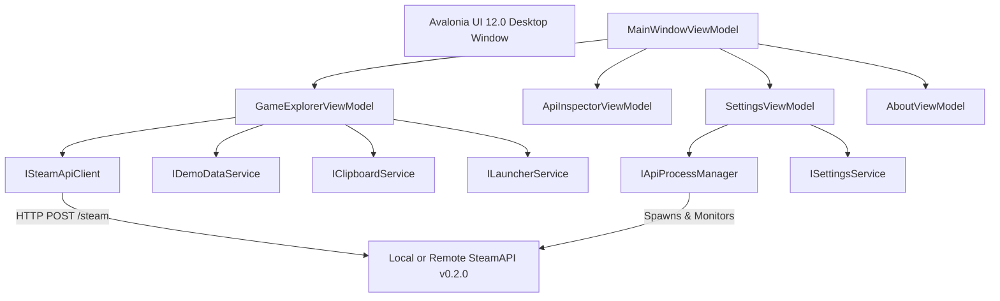

# SteamAPI Desktop

**Version:** `v0.1.0` — published October 16, 2026  
**Target Runtime:** `.NET 10.0` (C# 14)  
**UI Framework:** [Avalonia UI](https://avaloniaui.net/) `12.0.4`  
**Pattern:** MVVM (via `CommunityToolkit.Mvvm`)  
**Companion Backend:** [SteamAPI v0.2.0](https://github.com/fatihemres/SteamAPI)  
**License:** [Repository LICENSE](../LICENSE) — current repository notice: proprietary / all rights reserved  
**Financial Model:** **$0.00 / Zero Mandatory Recurring Costs**

---

## 1. Executive Summary & Product Vision

**SteamAPI Desktop** is a standalone, lightweight, cross-platform desktop application designed to explore the Steam catalog, test regional pricing, inspect raw API telemetry, and visualize the capabilities of the `SteamAPI` backend.

Built from the ground up on modern **.NET 10** and **Avalonia UI**, SteamAPI Desktop delivers a native, responsive dark-mode gaming aesthetic while maintaining strict compliance with the verified `SteamAPI v0.2.0` contract (`POST /steam`).

### Key Principles
* **Zero Mandatory Recurring Costs:** Local use requires no mandatory cloud subscription or paid hosting. The application uses third-party packages under their respective licenses; this does not make SteamAPI's original code open source.
* **Non-Invasive Architecture:** Preserves the existing ASP.NET Core `SteamAPI` project and its 157 baseline unit/integration tests without touching protected code.
* **Developer & User Friendly:** Functions both as an interactive visual consumer for everyday users and a rich API inspector for developers.
* **Configurable Local API:** Includes a supervised loopback child process manager and Offline Demo Mode. On a fresh installation, `AutoStartApi` is **false** and `DemoMode` is **false**; use Settings to start the companion API or enable automatic startup, or switch to Demo Mode to explore without a running backend.

---

## 2. Core Features & Capabilities

```
┌────────────────────────────────────────────────────────────────────────┐
│                        SteamAPI Desktop v0.1.0                         │
├───────────────┬───────────────────┬──────────────────┬─────────────────┤
│ 🎮 Explorer   │ 🔍 API Inspector  │ ⚙️ Settings      │ ℹ️ About & Help │
└───────────────┴───────────────────┴──────────────────┴─────────────────┘
```

### Feature 1: Game Explorer
* **Search Catalog:** Search titles by keyword with client-side input validation (length limits, non-empty checks).
* **Multi-Culture Storefront Switching:** Instantly query supported regional stores:
  * 🇹🇷 **Turkey (TR / Culture 1):** Turkish storefront (Primary targeted market).
  * 🇺🇸 **United States (US / Culture 2):** United States storefront (Validation & baseline market).
  * 🇪🇸 **Spain (ES / Culture 3):** Spain storefront (European validation market).
* **Game Cards & Selection:** View search results with game title, App ID badge, sale type badges (`PAID`, `FREE TO PLAY`, `NOT AVAILABLE`), and verified price formatting.

### Feature 2: Game Details Inspector
* Detailed slide-over sheet displaying:
  * Full game title and App ID badge.
  * Exact price formatted according to verified contract semantics.
  * Sale type classification.
  * Raw Steam store URL.
* **One-Click Native Launchers:**
  * `🚀 Open in Steam Client`: Launches `steam://store/{appId}` directly in the local desktop Steam client.
  * `🌐 View Store Webpage`: Opens the official web store page in the default system browser.
  * `📋 Copy App ID`: Copies the numeric App ID to the system clipboard.
  * `📋 Copy Store Link`: Copies the canonical store URL to the system clipboard.

### Feature 3: Live HTTP API Inspector
* Dedicated telemetry tab capturing live HTTP network transactions between desktop client and API server.
* **History Log:** Retains up to 50 recent HTTP calls displaying HTTP method (`POST`), status code badges (e.g. `200 OK` green, `400 Bad Request` yellow, `502/504` red), round-trip latency (`ms`), and timestamps.
* **Payload Inspection:** Formatted JSON viewers for both request payloads and response bodies with syntax coloring and one-click clipboard copying.

### Feature 4: Bundled Loopback Server (Child Process Manager)
* Can discover and manage a local `SteamAPI` backend process when started from Settings or when the user explicitly enables **Auto-start API**; it is not launched automatically with default settings.
* Binds strictly to `http://127.0.0.1:5271` to prevent unwanted network exposure.
* Performs socket-level port conflict detection.
* Graceful lifecycle management: guarantees termination of the child process tree upon desktop application exit.

### Feature 5: Offline Demo Mode (Zero Dependencies)
* Built-in synthetic catalog simulator.
* Allows instant offline testing and evaluation without an active internet connection or local API server.
* Clearly marks synthetic items with `[SYNTHETIC DEMO]` to prevent misrepresentation.
* Simulates regional price variations across Turkey, United States, and Spain.

---

## 3. Technology Stack & Architecture



| Component | Technology | Version | Purpose |
| :--- | :--- | :--- | :--- |
| **Language & Runtime** | C# 14 / .NET 10 | `net10.0` | High-performance modern language runtime |
| **Desktop UI Framework** | Avalonia UI | `12.0.4` | Cross-platform XAML UI with SkiaSharp rendering |
| **MVVM Toolkit** | CommunityToolkit.Mvvm | `8.4.1` | Source-generated MVVM observable properties & commands |
| **JSON Serialization** | System.Text.Json | Built-in | Fast, memory-efficient JSON serialization |
| **Unit Testing** | xUnit & Microsoft.NET.Test.Sdk | `2.9.3` | Automated unit, regression, and telemetry tests |

---

## 4. First-Run & Quickstart Guide

### Option A: Recommended Windows Installer (Primary Release Download)

1. **Download:** Grab `SteamAPI-Desktop-Setup-v0.1.0-win-x64.exe` from GitHub Releases or the Actions artifact bundle.
2. **Checksum Verification:** Verify the SHA-256 checksum against the matching `.sha256` sidecar file:
   ```powershell
   Get-FileHash -Algorithm SHA256 .\SteamAPI-Desktop-Setup-v0.1.0-win-x64.exe
   ```
3. **Installation:** Run the setup executable.
   * **Per-User Non-Admin Setup:** Installs directly to `%LOCALAPPDATA%\Programs\SteamAPI Desktop` without requiring administrative UAC elevation.
   * **Custom Path:** The destination directory can be customized during setup.
   * **Start Menu & Shortcuts:** Creates a Start Menu entry (`SteamAPI Desktop`) and provides an optional desktop shortcut task.
   * **SmartScreen Note:** The published Windows installer is not claimed to be Authenticode-signed. Windows may show an "Unknown Publisher" or SmartScreen warning. Verify the official GitHub Release and its checksum, and review the publisher trust warning before deciding whether to run it.
4. **Upgrades:** Future versions can be installed directly over existing installations; the installer uses a persistent Application ID GUID to perform safe in-place upgrades.
5. **Uninstallation:** Registered in standard Windows Settings (**Installed Apps** / **Add or Remove Programs**). The clean uninstaller removes all installed application binaries and shortcuts without touching unrelated files.
6. **User Settings Preservation:** Custom settings located at `%APPDATA%\SteamAPI.Desktop\settings.json` are strictly preserved across upgrades, reinstalls, and uninstallation.

### Option B: Portable ZIP Archive (Advanced / Developer Alternative)

For environments where installation is restricted or for portable USB usage:
1. Download `SteamAPI-Desktop-v0.1.0-win-x64.zip` and verify SHA-256 checksum:
   ```powershell
   Get-FileHash -Algorithm SHA256 .\SteamAPI-Desktop-v0.1.0-win-x64.zip
   ```
2. Extract the archive into any local folder.
3. Launch `SteamAPI.Desktop.exe` directly.

### Option C: Building from Source
Prerequisites: [.NET 10.0 SDK](https://dotnet.microsoft.com/download/dotnet/10.0)

```powershell
# Clone the repository
git clone https://github.com/fatihemres/SteamAPI.git
cd SteamAPI

# Restore dependencies
dotnet restore SteamAPI.sln

# Build complete solution (backend + tests + desktop)
dotnet build SteamAPI.sln

# Run all 222 automated tests
dotnet test SteamAPI.sln

# Run the desktop application
dotnet run --project desktop/SteamAPI.Desktop/SteamAPI.Desktop.csproj
```

---

## 5. Regional Storefront Cultures

`SteamAPI` v0.2.0 natively accepts three culture IDs corresponding to specific Steam regional storefronts:

| Culture ID | Country Code | Language | Market Description |
| :---: | :---: | :---: | :--- |
| **1** | `TR` | `turkish` | **Turkey:** Primary targeted storefront market. |
| **2** | `US` | `english` | **United States:** Validation & baseline storefront market. |
| **3** | `ES` | `spanish` | **Spain:** European validation storefront market. |

---

## 6. Verification & Automated Test Suite

SteamAPI maintains 100% test pass rates across all layers:

* **Baseline SteamAPI Tests:** 157 / 157 passing (100% green).
* **SteamAPI Desktop Tests:** 65 / 65 passing (100% green).
* **Total Executed Tests:** **222 / 222 passing** across solution.

Test coverage for Desktop includes:
* `SteamGameListingTests`: 6-field contract serialization and display price formatting.
* `SteamCultureTests`: Regional culture enumeration and mappings.
* `DemoDataServiceTests`: Synthetic catalog querying, filtering, and regional adjustments.
* `SteamApiClientTests`: HTTP handling (200 OK, 400 Validation ProblemDetails, 502/504 errors, network exceptions, telemetry event emission).
* `GameExplorerViewModelTests`: Input validation, search dispatching, selection, clipboard and launcher interactions.
* `ApiInspectorViewModelTests`: Telemetry record collection, FIFO capping at 50 items, payload copying.
* `SettingsViewModelTests`: Settings loading, persistence, default reset, connection testing.
* `SettingsServiceTests`: Isolated JSON configuration persistence on disk.
* `MainWindowViewModelTests`: Navigation tab transitions and lifecycle process cleanup.
* `AboutViewModelTests`: Metadata and external link verification.

---

## 7. Packaging & Distribution

To create an official release package and checksum:

```powershell
# Run the automated packaging script
.\desktop\package-release.ps1
```

This generates:
* `artifacts/releases/SteamAPI-Desktop-Setup-v0.1.0-win-x64.exe`
* `artifacts/releases/SteamAPI-Desktop-Setup-v0.1.0-win-x64.exe.sha256`
* `artifacts/releases/SteamAPI-Desktop-v0.1.0-win-x64.zip`
* `artifacts/releases/SteamAPI-Desktop-v0.1.0-win-x64.zip.sha256`

---

## 8. Author & Creator Attribution

SteamAPI and SteamAPI Desktop are created, designed, and maintained by:

* **Creator & Author:** **Fatih Emre Sarman**
* **GitHub Profile:** [@fatihemres](https://github.com/fatihemres)
* **Official Repository:** [https://github.com/fatihemres/SteamAPI](https://github.com/fatihemres/SteamAPI)
* **Copyright:** `Copyright © 2026 Fatih Emre Sarman`

---

## 9. Release Authenticity & Verification

To verify that a downloaded binary or package originates from the official repository:

1. **Official Release Source:** Download binaries strictly from the official GitHub repository releases at [https://github.com/fatihemres/SteamAPI/releases](https://github.com/fatihemres/SteamAPI/releases).
2. **Cryptographic Checksums:** Compare the computed SHA-256 hash of the archive against the published `.sha256` manifest:
   ```powershell
   Get-FileHash -Algorithm SHA256 .\SteamAPI-Desktop-v0.1.0-win-x64.zip
   ```
3. **Git Commit & Tag Verification:** Check the release tag and its target commit in the official GitHub repository. **Do not assume the tag or binary is digitally signed** unless a verifiable signature is provided.
4. **Integrity vs. Attribution:** A matching SHA-256 checksum detects file changes relative to the published checksum, but a checksum distributed alongside the file is **not a publisher signature**. Use the official repository's release provenance and Git history to assess origin; do not infer code-signing from the presence of a checksum.

---

## 10. Licensing & Trademarks

### Software License
The current repository-level [LICENSE](../LICENSE) describes the original, owner-controlled SteamAPI and SteamAPI Desktop materials as **proprietary / all rights reserved**, subject to third-party rights and previously valid grants. This is **not** a general MIT-licensed or open-source repository.

Earlier versions of this Desktop README described an **MIT licensing proposal** and included a partial permission notice inconsistent with the current repository-level notice. This documentation correction does not determine the legal effect of any earlier publication or revoke rights that were already validly granted. Review the historical terms and obtain appropriate legal advice if reuse permissions depend on those versions.

.NET, Avalonia, NuGet dependencies, fonts, images and other third-party material retain their own licenses and rights; consult their original notices.

### Trademark Disclaimer
> **Notice:** SteamAPI and SteamAPI Desktop are independent developer projects and are **not** affiliated with, authorized, maintained, sponsored, or endorsed by **Valve Corporation** or any of its affiliates.  
> *Steam* and the *Steam logo* are trademarks or registered trademarks of Valve Corporation in the United States and other countries.
